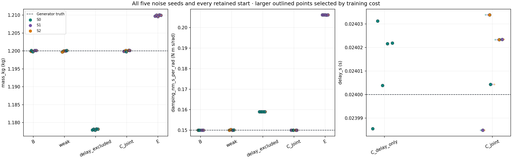
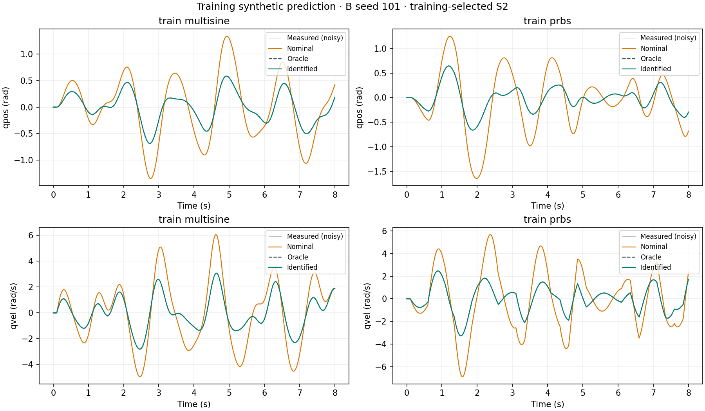
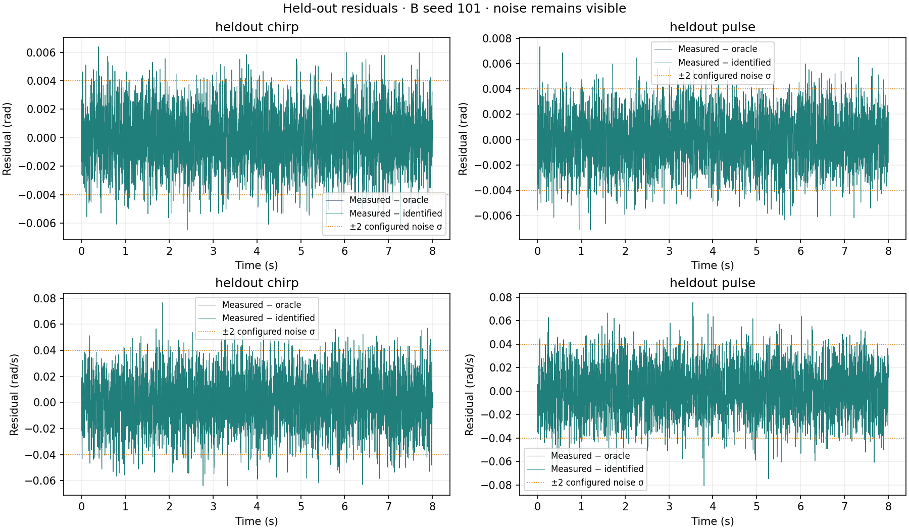

# MuJoCo System Identification Lab

A reproducible synthetic dynamics system-identification study that exercises the estimation, validation, and diagnostic workflow needed before applying the method to real traces.

An actuated one-joint pendulum generates noisy observations from hidden physical parameters. MuJoCo's official SysID toolbox starts from deliberately biased physics, estimates mass and damping using complete training trajectories, and predicts untouched chirp and pulse trajectories. Delay and an omitted friction-like torque expose errors that fitting alone can hide.

**All 82 registered fits completed and converged across five noise seeds and three starting points.** Matched-model held-out median position RMSE was **0.002003 rad**, and velocity RMSE was **0.019926 rad/s**: improvements of **99.69%** and **99.32%** over nominal. Both physical parameters recovered within 10% for **5/5 seeds**, and no fitted parameter hit a bound. The experiment is synthetic; it demonstrates no hardware deployment.


## Measured results

These are medians of the training-selected winner for seeds 101–105. Selection uses training cost only, including finite nonconverged candidates if any occur. All starting points, per-trajectory p95 errors, minimum/maximum results, convergence diagnostics, and raw references are retained in [summary.json](docs/results/summary.json) and [parameter_table.csv](docs/results/parameter_table.csv).

| Experiment | Training normalized RMSE | Held-out normalized RMSE | Finding |
|---|---:|---:|---|
| Matched mass + damping | 0.995 | 0.997 | Predictions reach the injected observation-noise scale. |
| Single step training | 1.005 | 0.998 | This step **was sufficient** in this controlled system; worst damping error was 0.1914%. |
| Delayed data, delay excluded | 11.757 | 14.282 | Timing error biases mass by about 1.82% and damping by 6.02%. |
| Delay only, selected physics fixed | 0.995 | 0.997 | Shared 24 ms delay recovered; fixed-physics residual phase lag falls from 24 ms to zero. |
| Joint mass + damping + delay | 0.995 | 0.997 | Largest delay error was **0.03384 ms**, below the registered 2 ms target. |
| Omitted friction-like torque | 5.520 | 8.973 | Held-out errors improve, but damping is biased by **37.48%**. |

Normalized RMSE weights position and velocity by their known noise scales, 0.002 rad and 0.02 rad/s. A value near one is consistent with the injected noise in the matched experiment. The mismatch residual remains clearly above noise: reduced fitting loss does not make the inferred damping physically correct. All mismatch fits converged; this supports model misspecification as the explanation, without proving structural non-identifiability or validating a real robot.

The step ablation does not support a claim that a step is always inadequate. Geometry, actuator gain, gravity, and initial state are known here; the transient and steady state both carry information. Its local scaled-Jacobian condition number was about 3.38, versus 1.34 for rich excitation. This is a small-system result, not a general identifiability guarantee.




## Reproduce on CPU

The released dependency is `mujoco[sysid]==3.15.0`, with direct dependency pins and transitive hashes in [pyproject.toml](pyproject.toml) and [uv.lock](uv.lock). Use Python 3.12.5 and uv 0.12.10.

```sh
uv sync --locked --python 3.12.5
uv run --locked python scripts/run_experiment.py --config configs/evidence_v1.json
```

The full command generates the versioned datasets, runs the registered matrix, seals training-only selections, evaluates complete held-out trajectories, saves official native results and HTML reports, and creates the public summary and figures. Leave `--output` unset for a new UTC-timestamped directory under ignored `artifacts/`. Existing evidence is never overwritten. Scientific target failures remain reported outcomes; incomplete execution exits nonzero.

The retained evidence invocation took **57.17 seconds** on an Apple M4 Pro with 12 CPU cores and 24 GB RAM, macOS 26.6.2, CPython 3.12.5, MuJoCo 3.15.0, and one rollout worker / one numerical-library thread. It ran **70 new fits and reused 12 immutable earlier fits** after checking their input/config/model identities. This timing covers generation, fitting, native reporting, and evaluation; final public curation and audit are timed separately. A fresh 82-fit invocation and remote CI have not been timed or verified. No MJX or GPU is used.

```sh
uv run --locked pytest -q
uv run --locked python scripts/run_smoke.py --config configs/smoke_v1.json
```

The smoke configuration is a separate, explicitly shortened 1.2-second verification experiment with one seed and one start. It is excluded from the 82-fit evidence count. [CI](.github/workflows/ci.yml) runs the tests and smoke on Ubuntu with pinned Python, uv, and action commits; only local execution is currently verified.

Data generation and an evaluation-only checkpoint are also available:

```sh
uv run --locked python scripts/generate_data.py --config configs/evidence_v1.json
uv run --locked python scripts/evaluate_milestone5.py
```

The second command requires the retained local Milestone 4 fit and Milestone 2 dataset, and performs zero optimization calls. Detailed checkpoint evidence appears in [docs/milestones](docs/milestones).

## Experimental contract

- One hinge, a rigid cylindrical link, torque motor, position/velocity sensors, fixed 2 ms timestep, and no contact. Mass changes scale COM rotational inertia consistently.
- True mass/damping: 1.20 kg / 0.15 N·m·s/rad. Nominal: 0.80 kg / 0.04 N·m·s/rad. Bounds: [0.40, 2.00] / [0.001, 0.50]. Known actuator gain: 1 N·m per control unit.
- Training: separate eight-second multisine and piecewise-constant trajectories. Held-out: separate eight-second chirp and different-amplitude pulses. Weak training: one sixteen-second step. Splits are complete trajectory IDs, never shuffled timesteps.
- Deterministic Gaussian noise uses independent PCG64 seed streams. Scenarios share innovations for paired comparisons. Target delay is applied to clean signals before adding noise; explicit equilibrium prehistory prevents padding or extrapolation.
- Starts S0/S1/S2, seeds 101–105, bounds, noise, solver settings, metrics, and success targets were frozen before identification in [registration_v1.json](docs/results/registration_v1.json). No thresholds or physical perturbations were tuned to improve results.
- Mismatch generation alone applies `-0.08*tanh(qvel/0.05)` N·m. The fitting family omits that effect. Under mismatch, the **fitting-family oracle** uses true mass/damping but still lacks the force; a separate **generator-aware clean-observation reference** measures the actual injected noise. The fitting-family oracle is consequently not a noise-floor reference there.

The estimator receives only training controls, measured observations, known initialization, nominal constants, and bounds. Physical truth is available to generation and post-selection evaluation. The explicitly oracle-assisted A1/A2 unit checks fix the other physical parameter to truth; joint fitting does not. Delay-only fitting fixes physics to that seed's sealed B winner, and joint delay fitting requires the registered delay-only prerequisite to pass.

The objective is `0.5 * sum(((measured - predicted) / sigma)**2)`. Official residuals and independently evaluated trajectory metrics are checked for agreement. Split RMSE gives each trajectory equal weight; p95 errors are retained per trajectory. Missing diagnostics use JSON null with a reason, never NaN/Inf. Confidence intervals are local linear approximations; mismatch intervals must not be read as uncertainty about true physics.




## Official API and evidence

The project uses `MjSpec`, bounded `ParameterDict`, named `TimeSeries`, explicit `create_initial_state`, `ModelSequences`, `build_residual_fn`, official `sysid.optimize` with `scipy_parallel_fd`, `save_results`, and the official HTML report builder. It does not substitute an independent optimizer.

Installed 3.15.0 behavior differs from examples in several consequential ways. The residual hook is `modify_residual`; frozen physical modifiers are skipped; mass helpers do not scale inertia by default; amplitude normalization differs from its docstring; rollout sensor/state labels have a one-timestep offset; and automatic delay-window cropping can discard an endpoint. The documented narrow adapter reconstructs this model's two joint sensors from integration states and uses the official delay resampler on a fixed safe observation grid. Tests cover alignment, delay sign/support, and exact sample counts. [spec.md](spec.md) records the inspected APIs, fixes, and unchanged scientific tolerances.

Official XML rounds this model's physical fields to six significant digits. Full-precision parameters, residuals, Jacobians, native pickles, and verified MuJoCo MJB binaries are preserved separately. The [official HTML report](docs/report.html) calls measured observations “nominal”; that label differs from this project's biased nominal model. Its parameter-change column compares with the starting reference, while the project JSON/CSV reports errors against generator truth. Interactive HTML charts use upstream CDN assets; an entirely offline interactive report is not demonstrated.

Every retained evidence run records exact configuration/hashes, seed, command, MuJoCo/Python/package versions, OS/CPU, thread settings, Git commit and dirty state, plus a reconstructable source snapshot for dirty runs. [The evidence audit](docs/results/evidence_audit.json) and [archive manifest](docs/results/archive.json) trace public results back to raw authored synthetic data and native fits. The raw archive remains local; public numeric summaries, figures, and official HTML are committed. Archive hash checking detects changed bytes but is not an independent scientific replication.

Earlier implementation failures are preserved: a provenance log-hash defect, stale report paths, XML rounding/save behavior, and the delay-window endpoint defect. Fixes address correctness; the frozen experimental configuration and acceptance thresholds remain unchanged.

## Verified and not demonstrated

**Verified locally:** synthetic parameter recovery; held-out synthetic trajectory prediction; sensitivity to excitation, delay, initialization, noise, and the registered model mismatch; official CPU pipeline, tests, smoke execution, and exact recorded runtime/environment. Five deterministic seeds are descriptive evidence, not a broad reliability study.

**Not demonstrated:** real robot data, hardware-in-the-loop, physical actuator calibration, contact-rich manipulation, real sim-to-real transfer, production deployment, or general parameter identifiability for arbitrary robots. The matched generator and estimator share a simulator family; one omitted effect does not establish real-world validity.
