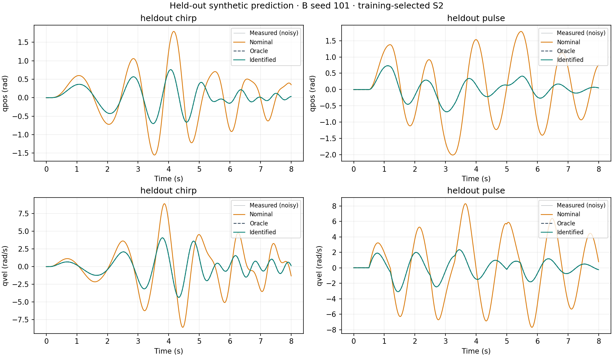
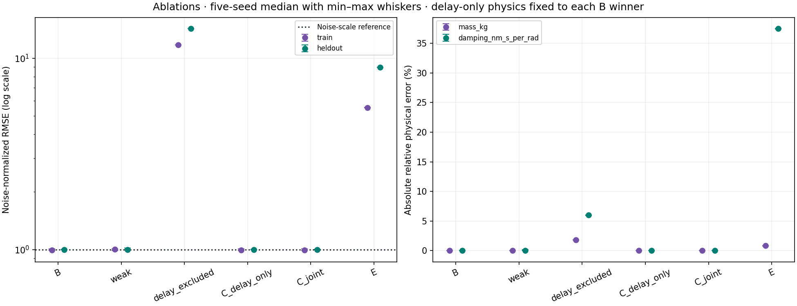
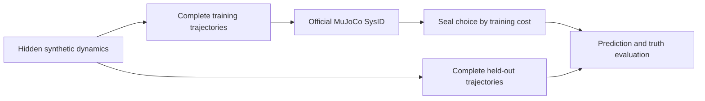

# MuJoCo System Identification Lab

A reproducible synthetic dynamics system-identification study that exercises the estimation, validation, and diagnostic workflow needed before applying the method to real traces.

A one-joint pendulum keeps the physics interpretable: known geometry and actuator gain, two physical parameters, and explicit sensor timing. Hidden dynamics generate noisy observations; a deliberately biased model estimates mass and damping with MuJoCo's official SysID toolbox, then predicts unseen control trajectories.

**All nine milestones completed. All 82 registered fits converged.** Across five noise seeds, matched-model held-out median RMSE was **0.002003 rad** for position and **0.019926 rad/s** for velocity—**99.69% / 99.32% improvement** over nominal. Both physical parameters recovered within 10% for **5/5 seeds**, with zero bound hits. [Compact results](docs/results/overview.json) · [Evidence index](docs/results/README.md) · [Official report](docs/report.html)



## Reproduce

Use Python 3.12.5 and uv 0.12.10; all dependency versions and transitive hashes are locked. CPU execution is sufficient.

```sh
git clone https://github.com/WeiHanTu/mujoco-system-identification-lab.git
cd mujoco-system-identification-lab
python3 -m pip install uv==0.12.10
uv sync --locked --python 3.12.5

# Short verification before the full study:
uv run --locked python scripts/run_smoke.py --config configs/smoke_v1.json
uv run --locked pytest -q

# Full dataset → fitting → held-out evaluation → reports/figures:
uv run --locked python scripts/run_experiment.py --config configs/evidence_v1.json
```

Leave `--output` unset for a fresh timestamped directory under ignored `artifacts/`; existing evidence is rejected. `--fresh` disables historical fit reuse. The full command updates public results from stored evidence. The separate 1.2-second, one-start smoke contributes zero registered evidence fits.

The retained full invocation took **57.17 s**, with **70 new fits and 12 immutable earlier fits reused**. Public curation took **2.08 s** separately. Environment: Apple M4 Pro, 12 CPU cores, 24 GB RAM, macOS 26.6.2, CPython 3.12.5, MuJoCo 3.15.0, one rollout worker and one numerical-library thread. An uncached 82-fit runtime and remote CI have not been verified. No MJX/GPU is used.

[Development and archive commands](docs/development.md) · [Python interfaces](docs/api.md) · [CI workflow](.github/workflows/ci.yml)

## Findings

Medians below use the winner selected by **training cost only** for seeds 101–105. Nominal/oracle parameter errors appear in the [baseline table](docs/results/baseline_parameters.csv). All three starts, per-trajectory p95 errors, minimum/maximum values, convergence diagnostics, and references remain in [full JSON](docs/results/summary.json) and [parameter CSV](docs/results/parameter_table.csv).

| Experiment | Training normalized RMSE | Held-out normalized RMSE | Finding |
|---|---:|---:|---|
| Matched mass + damping | 0.995 | 0.997 | Predictions reach the injected observation-noise scale. |
| One step for training | 1.005 | 0.998 | **Sufficient here:** worst damping error 0.1914%. |
| Delayed data, delay omitted | 11.757 | 14.282 | Mass/damping absorb timing error: about 1.82% / 6.02% bias. |
| Delay only, selected physics fixed | 0.995 | 0.997 | Same-physics residual lag falls from 24 ms to zero. |
| Joint physics + delay | 0.995 | 0.997 | Maximum delay error **0.03384 ms**, below the 2 ms target. |
| Omitted friction-like torque | 5.520 | 8.973 | Prediction improves, but damping is biased **37.48%**. |

Noise-normalized RMSE uses known scales of 0.002 rad and 0.02 rad/s. The mismatch residual stays clearly above noise: substantially reduced fitting loss does not establish physically correct damping. Its fitting-family oracle omits the force; a separate generator-aware reference measures injected noise.

The weak-step result does **not** support claiming that a step always lacks information. Known geometry/gain, its transient, and its steady state were sufficient here. Three initializations produced nearly identical solutions; tiny floating-point cost differences decide the recorded winner. Neither outcome establishes identifiability for arbitrary robots.



## Experimental design



The hinge/link model uses a torque motor, position/velocity sensors, 2 ms timestep, and no contacts. True mass/damping are 1.20 kg / 0.15 N·m·s/rad; nominal values are 0.80 / 0.04. Bounds are [0.40, 2.00] / [0.001, 0.50]. Mass changes scale COM inertia consistently; geometry, gain, gravity, and initialization stay known.

Training uses separate eight-second multisine and piecewise-constant trajectories. Held-out controls are an eight-second chirp and different-amplitude pulses. The weak ablation uses one sixteen-second step with similar sampled control energy but different horizons/resets. Splits use whole trajectory IDs. Scenarios share deterministic noise innovations for paired comparisons. Delay is applied before noise with explicit prehistory; the mismatch generator alone adds `-0.08*tanh(qvel/0.05)` N·m.

The estimator sees restricted training observations and known/nominal constants. Truth is used for generation and after-selection evaluation; the explicitly oracle-assisted single-parameter checks are the controlled exception. Starts, seeds, bounds, metrics, solver settings, and targets were [registered before fitting](docs/results/registration_v1.json). No threshold was loosened to improve outcomes.

The official pipeline uses `MjSpec`, `ParameterDict`, `TimeSeries`, explicit initial state, `ModelSequences`, `build_residual_fn`, `sysid.optimize` with `scipy_parallel_fd`, and official native/HTML reporting. Installed API/timing defects required a narrow, tested adapter; [spec.md](spec.md) documents those corrections. Full-precision MJB/native arrays accompany rounded XML. Local confidence intervals do not imply true-physics coverage under mismatch.

## Verification and scope

[Milestone 9 audit](docs/milestones/09_final_audit.md) records **541 passing tests**, the CPU smoke, independent reproduction of all 82 fits' residuals/metrics, visual report checks, and the verified local archive. [Verification metadata](docs/results/verification.json) and [archive inventory](docs/results/archive.json) include exact commands, configs, seeds, versions, CPU/OS, source commits/hashes, and dirty-state snapshots. Earlier implementation failures are retained. GitHub displays HTML source; [the results index](docs/results/README.md) explains local report viewing.

**Verified locally:** synthetic parameter recovery; held-out synthetic prediction; sensitivity to excitation, delay, noise, initialization, and the registered mismatch; official CPU workflow and recorded environment/runtime. Five seeds provide descriptive evidence.

**Not demonstrated:** real robot data, hardware-in-the-loop, physical actuator calibration, contact-rich manipulation, real sim-to-real transfer, production deployment, or general identifiability for arbitrary robots. Generation and fitting share a simulator family. Remote CI is configured but has not run.
