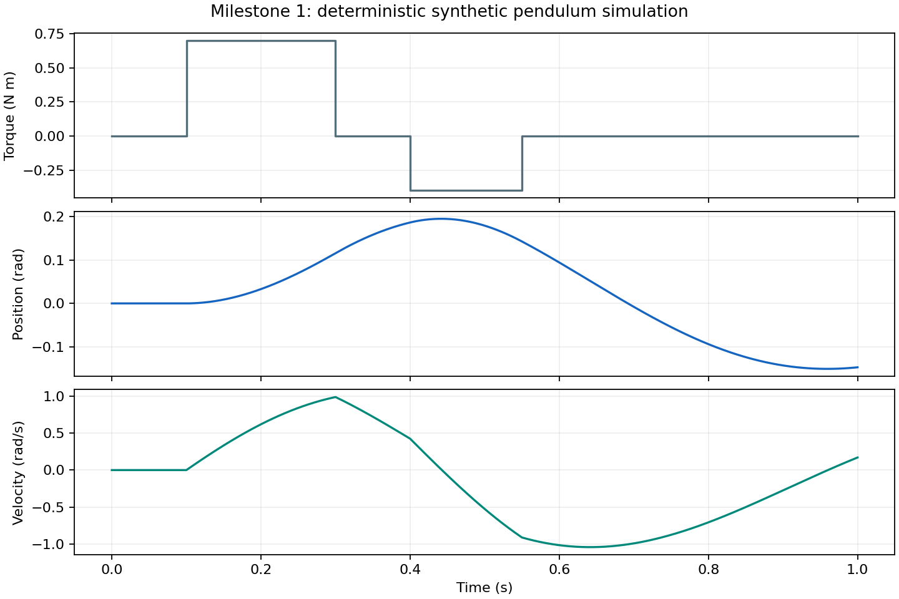

# mujoco-system-identification-lab

A reproducible synthetic dynamics system-identification study that exercises the estimation, validation, and diagnostic workflow needed before applying the method to real traces.

Completed: Milestone 1 environment, installed API, and deterministic simulation verification. The local suite passed 86 tests. A one-second trajectory produced 501 finite samples and repeated exactly; the aligned official residual was zero. Identification and held-out evaluation are subsequent milestones; no parameter-recovery result is claimed yet.



[Milestone 1 verification](docs/milestones/01_environment.md) · [Machine-readable evidence](docs/results/milestone1.json)

The authored model is a single actuated hinge with a uniform rigid link. Ground-truth mass is 1.20 kg and damping is 0.15 N*m*s/rad; the nominal model starts at 0.80 kg and 0.04 N*m*s/rad. Geometry, COM, gravity, motor gain, and initial state are known. Mass and COM inertia scale together. The timestep is 0.002 s and all rollouts run on CPU.

## Reproduce Milestone 1

With the existing locked environment, run from the repository root:

```sh
.venv/bin/python scripts/verify_milestone1.py --config configs/milestone1.json
```

Leave `--output` unset for repeat runs. Each invocation creates a fresh UTC-timestamped directory under `artifacts/milestone1/`. An explicit output directory must be new; the runner refuses to overwrite retained evidence. The dated explicit-output command in the milestone record documents a historical run and is not a rerun command.

Python 3.12.5 is the recorded interpreter. Direct dependencies and every resolved runtime dependency are pinned in pyproject.toml and uv.lock. The project has no dependency on MuJoCo Git main.

```sh
uv sync --locked --python 3.12.5
uv run --locked python scripts/verify_milestone1.py --config configs/milestone1.json
uv run --locked pytest
```

Run from a committed checkout. The verification command refuses to retain results without a real Git commit. It writes a new ignored artifacts/milestone1/<run_id>/ directory containing strict JSON provenance/API checks, raw trajectory NPZ, and a simulation plot. It records dirty state and snapshots dirty authored source. Existing output directories are never overwritten.

The retained evidence run used clean source commit `4ad8657763b7568e1f16d92d3a3808cb739488c9`, Python 3.12.5, MuJoCo 3.15.0, macOS 26.6.2, and an Apple M4 Pro (12 cores, 24 GB). It completed verification in 0.681 s with a warm font cache; the two one-second simulated rollouts took 0.00182 and 0.00173 s. This does not predict full-study runtime. Remote CI has not run.

Raw evidence is archived locally in ignored artifacts/milestone1/20261012_evidence.tar.gz, including the earlier run's retained audit failure. The archive SHA256 and exact creation command are in docs/results/milestone1.json. The first run hashed its still-active console log; a regression test and a new source commit corrected that provenance defect. No physical parameters or acceptance thresholds changed.

The verification trajectory has two small torque pulses and runs twice without noise. The seed is recorded, but this noiseless check uses no randomness. Tests separately cover equilibrium, one-step analytic dynamics, control/sensor timing, inertia scaling, invalid configs/bounds, and provenance. Local determinism does not imply bitwise equality across platforms.

## Installed SysID integration

The intended estimator uses official MjSpec, bounded ParameterDict, TimeSeries, ModelSequences, build_residual_fn, sysid.optimize, save_results, and default_report. The registered solver is the toolbox's official scipy_parallel_fd backend; it retains MuJoCo rollout/Jacobian evaluation while providing SciPy termination diagnostics.

The released package requires explicit handling of several contracts: frozen physical modifiers are skipped; mass helpers do not scale inertia by default; the default residual adds amplitude scaling; optimizer max_iters maps to a function-evaluation budget; and HTML reporting is separate from save_results. Installed source fingerprints and runtime probes document these behaviors.

For this exact jointpos/jointvel sensor pair, MuJoCo rollout sensor output precedes integration, while the SysID conversion uses post-step state timestamps. A narrow supported modify_residual hook reconstructs these two observations from the returned integration states, with explicit initial observation and a fixed safe delay window. This preserves physical timestamps rather than absorbing a numerical offset into the estimated delay. It is deliberately limited to the authored one-DOF sensor layout.

Pure noise weighting disables the upstream amplitude normalization. The official residual sign is measured minus predicted; scalar least-squares loss and RMSE are unchanged by this sign convention. No alternate optimizer is implemented.

## Planned evidence

The registered study contains 82 fits: independent physical checks, joint recovery, weak excitation, omitted/modeled delay, five noise seeds, three initializations, and model mismatch. Training uses multisine and piecewise-constant excitation; chirp and pulse controls remain completely held out. Start selection uses training objective only.

The primary result will be held-out synthetic prediction improvement. Every seed/start and failure will remain visible. The weak step is allowed to identify both parameters; model mismatch is allowed to yield an inconclusive bias result. Neither ablation is tuned to force a preferred story.

See [spec.md](spec.md) for exact configuration, metrics, thresholds, noise keys, solver options, and oracle definitions; [plan.md](plan.md) for all nine milestone gates; [intend.md](intend.md) for claim boundaries.

## Claim boundaries

This project is synthetic workflow validation. The matched generator and fitting model use the same simulator family.

Verified so far: released package imports, inspected/executed API contracts, deterministic CPU simulation, mass/inertia consistency, and explicit sensor timing/noise-weighting checks. Synthetic parameter recovery, held-out prediction, excitation/delay/initialization sensitivity, and model-mismatch results require later evidence.

Not demonstrated: real robot data, real-robot validation, hardware-in-the-loop, physical actuator calibration, contact-rich manipulation, real sim-to-real transfer, production deployment, or general parameter identifiability for arbitrary robots.

All models and data are authored synthetic assets. Raw runs stay in ignored artifacts/. Bilingual interview notes stay in ignored private/ and must not be published to GitHub.
