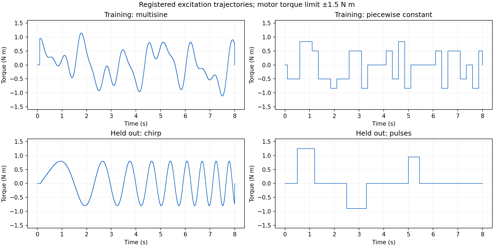
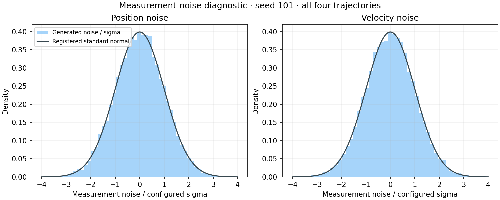

# Milestone 2 synthetic datasets and baseline verification

Verified locally on 2026-10-12, America/Los_Angeles. This checkpoint covers deterministic matched-model synthetic data, a complete-trajectory split, nominal/oracle evaluation, and frozen study registration. Identification count is zero.

## Reproduce

Run from the repository root:

```sh
.venv/bin/python scripts/generate_data.py --config configs/evidence_v1.json
```

Leaving `--output` unset creates a new UTC-timestamped run directory under `artifacts/milestone2/`. Existing directories are rejected to preserve evidence. The exact historical command, including its already-used output path, is recorded in [milestone2.json](../results/milestone2.json); use the command above for reruns.

Python 3.12.5 and the committed `uv.lock` define the environment. If synchronization is needed:

```sh
uv sync --locked --python 3.12.5
.venv/bin/python -m pytest
```

## Retained evidence

- Verified run: `artifacts/milestone2/20261012_seed101_verified/`.
- Source commit: `fa40206800643ff9e0b44bafed02a036ab47a3a3`; clean at run start.
- MuJoCo 3.15.0; CPython 3.12.5; macOS 26.6.2, ARM64; Apple M4 Pro, 12 CPU cores, 24 GB. Numerical-library thread settings are one; official fitting is not invoked.
- Noise seed: 101. Only this matched dataset is generated as retained study evidence here.
- Four complete trajectories: eight seconds, 0.002 s timestep, 4,001 samples and 4,000 driven control intervals each. Final control samples are zero and unused.
- Generation, deterministic-repeat checks, serialization verification, baseline metrics, and four plots: 1.290060 s. Generation plus its repeat took 0.212648 s. Neither measures optimizer runtime.
- Local suite: 270 passed in 4.41 s, with 17 upstream deprecation warnings visible. Remote CI has not run.

[Public summary](../results/milestone2.json) · [Every baseline metric row](../results/milestone2_baseline_metrics.csv) · [Full preregistration](../results/registration_v1.json)

## Data contract

The authored pendulum's hidden generator uses mass 1.20 kg and damping 0.15 N*m*s/rad. The nominal model uses 0.80 kg and 0.04 N*m*s/rad. Geometry, COM, gravity, gain, armature, initial state, and integration settings are shared. Mass changes scale the COM inertia consistently. No contact, process noise, or mismatch force is present in this dataset.

Training uses `train_multisine` and `train_prbs`. Held-out controls are `heldout_chirp` and `heldout_pulse`. Their complete trajectory IDs remain disjoint. The narrow training reader exposes timestamps, controls, measured qpos/qvel, and explicit known initial state; it does not expose truth, latent-clean data, nominal predictions, or held-out arrays. Regression tests remove held-out files and inspect loaded array keys to verify that boundary.

Controls drive [t[k], t[k+1]); fresh sensor values represent the state at t[k]. Multisine phases and chirp phase use active time beginning after the 0.10 s zero-control prefix. PRBS uses integer blocks of 125 simulation intervals, avoiding floating-point block-boundary drift. Its SeedSequence is [314159, 100, 1].

| Excitation | Peak torque (N*m) | Active RMS (N*m) | Sampled torque-squared integral (N*m)²*s |
|---|---:|---:|---:|
| Training multisine | 1.148401 | 0.550000 | 2.389750 |
| Training PRBS | 0.837879 | 0.550000 | 2.389750 |
| Held-out chirp | 0.800000 | 0.561415 | 2.489980 |
| Held-out pulse | 1.250000 | 0.521424 | 2.147875 |

Every peak is below the registered 1.5 N*m limit. No clipping is applied. RMS and the sampled torque-squared integral exclude the unused terminal control. The registered weak-step ablation is not part of this dataset; its single 16-second trajectory will have one reset and a different active duration from the two rich-training trajectories. No weak-excitation recovery claim is made.



Measurement noise is additive independent Gaussian: sigma_q = 0.002 rad, sigma_v = 0.020 rad/s. The deterministic generator uses PCG64 with SeedSequence([noise_seed, noise_group_id, trajectory_id, sensor_id]); this matched dataset uses group 0. Innovation arrays and their hashes are retained. Process noise is absent.

The matched sensor delay is zero. Each trajectory also saves a simulated equilibrium prehistory from -0.060 to 0 s, beginning from explicit zero position/velocity. It joins the zero-control prefix continuously. This provides actual history for later positive-delay generation without edge padding. Complete trajectories remain stored; the common residual/evaluation window is [0.060, 7.940] s, with 3,941 samples. Delay identification has not started.



## Baseline results

Nominal and oracle predictions use the same timestamps, controls, initial state, observation transform, fixed window, and shared metric evaluator. Split RMSE is sqrt(mean(per-trajectory RMSE²)), giving each trajectory equal weight. The noise-normalized metric is sqrt(mean((position_error/sigma_q)² + (velocity_error/sigma_v)²)/2).

| Split | Model | qpos RMSE (rad) | qvel RMSE (rad/s) | Noise-normalized RMSE |
|---|---|---:|---:|---:|
| Training | Nominal | 0.381333 | 1.670209 | 147.186569 |
| Training | Oracle | 0.002000 | 0.020062 | 1.001565 |
| Held-out | Nominal | 0.653406 | 2.946468 | 253.415854 |
| Held-out | Oracle | 0.001993 | 0.019927 | 0.996423 |

The oracle's residual is consistent with the registered noise scales because it uses generator-consistent physics. It is not a strict finite-sample lower bound. Large nominal residuals establish the deliberately biased starting model; they do not establish that SysID can recover its physics. An identified model is unavailable, with that reason recorded explicitly. No later success criterion has been evaluated.

Every trajectory's RMSE and p95 absolute errors are retained in the CSV and JSON. Split p95 is unavailable with an explicit reason; individual percentiles are not averaged into a purported pooled percentile. The registered name `noise_normalized_rmse` maps explicitly to the report/CSV field `normalized_rmse`.


## Frozen registration

The exact config content and file hashes are retained in [registration_v1.json](../results/registration_v1.json); the original bytes remain in the recorded Git commit:

- Evidence config SHA256: `f3e6deacceec9e6365b39e2c9067b9e3a8b71bab6a1c21f6f8e6ada4af824202`.
- Separate ground-truth config SHA256: `07c0aac32fe4147921572fdf3e8b134e49c991daa3468de27badb55ce9ef0f2f`.
- Mass bounds [0.40, 2.00] kg; damping [0.001, 0.50] N*m*s/rad; shared delay [0, 0.060] s.
- Seeds 101–105. S0/S1/S2 physical starts are (0.80, 0.04), (1.70, 0.30), and (0.50, 0.40); paired joint-delay starts are 0.002, 0.050, and 0.010 s. Delay-only starts at 0.002 s.
- Eight planned cells totaling 82 fits: A1/A2 1 each; matched, weak, delay-excluded, joint-delay, and mismatch 15 each; delay-only 5. All remain future work.
- Official `scipy_parallel_fd`, `trf`, linear loss, max_iters 200 mapped to max_nfev, tolerances 1e-8, diff_step 1e-5, free-parameter bound-width scaling, and training-only start selection. Noise weights are 1/sigma with amplitude normalization disabled.
- Physical recovery <=10% in at least 4/5 seeds; median held-out position/velocity improvement >=20%, with neither trajectory's median improvement negative; delay error <=0.002 s in at least 4/5 seeds; no consistent required-parameter bound pinning. Missing required rows count against the fixed denominator.
- CPU runtime targets remain smoke <=60 s and full study <=900 s. They are not verified by data generation.

Delay-only fits require that seed's immutable training-selected matched winner to recover both physical parameters within 10%. Joint-delay fits require a finite delay-only result within one timestep and timing tests that pass. Dependent cells remain explicitly unrun when prerequisites fail. Weak excitation and mismatch need not yield a positive result.

Any later revision requires a new version and explanation; this checkpoint does not authorize threshold changes based on outcomes or held-out results.

## Evidence audit and limitations

The first run's numeric trajectories and baseline metrics were valid, but its report used plot paths that omitted the `plots/` directory and lacked an explicit registered-to-serialized noise metric field mapping. Those metadata defects were corrected with regression checks and the new clean-source run. Original raw evidence remains under `artifacts/milestone2/20261012_seed101/`; configurations, numeric data, and acceptance thresholds were unchanged.

The local archive `artifacts/milestone2/20261012_evidence_verified.tar.gz` preserves both runs and their provenance. Its actual SHA256 and exact creation command are in [milestone2.json](../results/milestone2.json). The first archive is also preserved with an audit-failure record: default macOS tar added AppleDouble metadata files. The verified archive uses `--no-mac-metadata` and is compared byte for byte against authored inputs. Raw NPZ data, array/file hashes, configs, seeds, package/environment versions, source commit/dirty state, and commands remain auditable there. Archive publication is a separate action.

This is synthetic baseline verification using the same simulator family for generation and fitting. Parameter recovery, fitted held-out prediction, multi-seed robustness, estimated delay, and model-mismatch sensitivity are not yet demonstrated. Real-robot data, HIL, physical actuator calibration, contact-rich manipulation, real sim-to-real transfer, production deployment, and general robot identifiability are outside the demonstrated scope.

## Checkpoint

Milestone 2 passed. Stop before Milestone 3. The next authorized continuation will build the official SysID pipeline and independently test mass and damping recovery; no fitting has occurred at this checkpoint.
