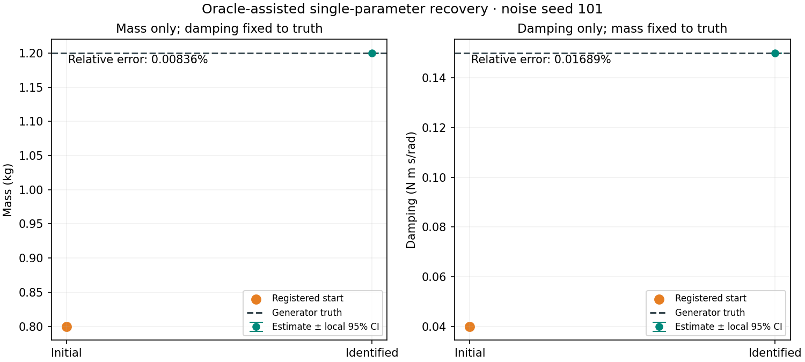

# Milestone 3 — Independent physical recovery

Milestone 3 passed: MuJoCo 3.15.0's official SysID pipeline recovered mass and damping independently in two seed-101 evidence fits and two noiseless checks. These are explicitly oracle-assisted unit experiments. A1 fixes damping to its true 0.15 N*m*s/rad and estimates mass from 0.80 kg; A2 fixes mass to its true 1.20 kg and estimates damping from 0.04 N*m*s/rad.

Completed matrix accounting is **2/82 registered evidence fits**, plus **two separately labeled noiseless sanity checks**. Joint recovery, multiple starts, five-seed robustness, delay, mismatch, and identified-model held-out improvement have not been evaluated. Stop before Milestone 4.

[Summary JSON](../results/milestone3.json) · [Parameter CSV](../results/milestone3_parameter_table.csv) · Official noisy reports: [A1 mass](../reports/milestone3/A1/report.html), [A2 damping](../reports/milestone3/A2/report.html)



## Registered inputs and objective

Both complete eight-second training trajectories—multisine and seeded piecewise-constant controls—enter each fit. Each contains 4,001 state-time samples at 0.002 s; the fixed inclusive observation window [0.060, 7.940] s retains 3,941 samples per trajectory. Two sensors and two trajectories produce 15,764 residual entries. Noise seed 101 uses independent Gaussian observation noise with sigma 0.002 rad and 0.020 rad/s. Noiseless checks remove observation noise while keeping these positive residual scales.

The estimator receives sanitized training controls, measured position/velocity, timestamps, and the exact known initial state. The A1/A2 harness stamps the known nuisance physical parameter into the spec. This controlled exception does not authorize passing truth to joint fitting. Held-out chirp and pulse controls, latent clean targets, and truth metadata are excluded from the optimizer interface; no fitted held-out metrics were generated.

The objective is `0.5*sum(r**2)`, with `r=(measured-predicted)/sigma`; upstream amplitude normalization is disabled. Official MjSpec, bounded ParameterDict, TimeSeries, explicit initial states, ModelSequences, and build_residual_fn feed `sysid.optimize(optimizer="scipy_parallel_fd")`. The registered linear `trf` settings, bound-width parameter scaling, 200 function-evaluation budget, and finite-difference step remain unchanged. No separate optimizer is implemented.

Mass bounds are [0.40, 2.00] kg; damping bounds are [0.001, 0.50] N*m*s/rad. Mass modifiers scale all COM inertia components with mass. Fixed quantities include geometry, COM, gravity, motor gain, armature, dry friction, and initialization. Candidate model builds operate on copies, preserving the registered spec.

## Recovery and optimization

| Fit | Estimate | Absolute error | Relative error | Bound hit | Initial objective | Final objective |
|---|---:|---:|---:|---|---:|---:|
| A1 noisy mass (kg) | 1.1998996613593147 | 1.0033864e-4 kg | 0.00836155% | No | 15,888,124.0165 | 7,906.17282970 |
| A2 noisy damping (N*m*s/rad) | 0.15002534185652405 | 2.5341857e-5 N*m*s/rad | 0.01689457% | No | 25,239,640.4137 | 7,906.11160546 |
| A1 noiseless mass (kg) | 1.2000000000000048 | 4.8849813e-15 kg | 4.0708178e-13% | No | 15,885,797.6408 | 1.1686405e-21 |
| A2 noiseless damping (N*m*s/rad) | 0.1500000000000001 | 1.1102230e-16 N*m*s/rad | 7.4014868e-14% | No | 25,221,812.2576 | 3.4579026e-23 |

Both noisy errors are below the registered 10% individual check threshold. Both noiseless errors are below the unchanged 0.1% numerical sanity threshold. These results do not satisfy the later joint-recovery target of at least 4/5 seeds.

| Fit | Success / termination | Native nfev | Native njev | Callback events | Fit runtime (s) |
|---|---|---:|---:|---:|---:|
| A1 noisy | True; `ftol` and `xtol` (status 4) | 7 | 7 | 6 | 0.218138 |
| A2 noisy | True; `ftol` (status 2) | 7 | 7 | 6 | 0.204154 |
| A1 noiseless | True; `xtol` (status 3) | 7 | 7 | 6 | 0.209441 |
| A2 noiseless | True; `xtol` (status 3) | 8 | 8 | 7 | 0.227657 |

Fit runtimes include initial residual, optimization, and final residual evaluation; they exclude subsequent official saving/reporting. Native `nfev` does not include all batched finite-difference or reporting work. The retained call ledger records those operations separately. SciPy exposes no `nit` here, so iteration count is null with a reason; callback events are not relabeled as iterations.

## Training predictions and local sensitivity

All rows use the shared evaluator and fixed window, with equal trajectory weighting. Each initial unit model has the nuisance parameter fixed to truth, so it differs from the fully biased Milestone 2 nominal baseline.

| Noisy fit | Model | qpos RMSE (rad) | qvel RMSE (rad/s) | Noise-normalized RMSE |
|---|---|---:|---:|---:|
| A1 | Initial unit model | 0.116924215 | 0.495450328 | 44.8970799 |
| A1 | Identified unit model | 0.001999863 | 0.020062604 | 1.00153225 |
| A2 | Initial unit model | 0.143725299 | 0.704310784 | 56.5878725 |
| A2 | Identified unit model | 0.001999904 | 0.020062049 | 1.00152837 |
| Both | Matched oracle | 0.002000049 | 0.020062063 | 1.00156502 |

Official residual objectives and objectives reconstructed from shared trajectory metrics agree. Per-trajectory p95 errors remain in the machine-readable rows; no average of p95 values is presented as a pooled percentile. The oracle residual contains measurement noise and is not a strict finite-sample lower bound.

The noisy A1 and A2 bound-width-scaled Jacobians each have shape [15,764, 1], rank 1, and singular values 16,223.4307 and 21,178.5758. Their one-column condition number is 1 by construction; this does not establish whether mass and damping can be distinguished jointly.

Official `sysid.calculate_intervals` returns 95% local Student-t half widths: 0.0001936143 kg for A1 and 0.00004625538 N*m*s/rad for A2. The corresponding intervals are [1.1997060471, 1.2000932757] kg and [0.1499790865, 0.1500715972] N*m*s/rad. They use estimated normalized residual variance `sum(r**2)/(N-P)` and assume a matched model, independent Gaussian observation errors, a suitable optimum, and local linear sensitivity. They are conditional on the nuisance parameter being known. They are not multi-seed robustness intervals or evidence of real-world validity. Noiseless checks explicitly mark statistical confidence intervals unavailable.

## Reporting failure retained and repaired

The original clean-source batch completed all four optimizations but failed the two noisy XML report checks. Official XML serialized mass 1.1998996613593147 as 1.1999 and damping 0.15002534185652405 as 0.150025. Comparing that rounded XML directly against full-precision fitted values at 1e-12 was an incorrect file-verification assumption.

Installed MuJoCo 3.15.0 runtime probes confirmed six significant digits across six mass/damping fixtures, including rounding boundaries. XML verification now uses the explicit quantized serialization target with **unchanged `rtol=atol=1e-12`**. Serialization errors are saved separately. Full-precision estimates remain in official parameter YAML and optimizer pickle; an official `mj_saveModel` MJB round trip preserves the compiled physical fields exactly. Official XML is preserved as generated. No recovery threshold or registered config was changed.

Copied report groups receive fitted modifiers and are compiled before `sysid.save_results`; otherwise MjSpec can serialize a stale compiled snapshot. Compiled XML checks verify mass, inertia, COM, and damping. The registered source spec remains unchanged. Official `default_report` generates HTML with videos disabled; a public ReportBuilder section explains interpretation boundaries.

The official observation legend `nominal` means measured observations. Its parameter-error table uses the starting reference rather than hidden truth, and its bound highlighting differs from the project's 0.001-times-bound-width rule. Project fit summaries are authoritative for physical truth errors and bound hits. The upstream trace's `Iteration` label does not change the recorded initial/callback/final event semantics.

The two public HTML reports were opened in a browser; their controls, observation plots, and interpretation sections rendered, with no recorded browser errors. The official template references versioned Plotly JavaScript from a CDN and Google Fonts. Offline interactive rendering has not been verified; the numerical results, CSV, and static figure are retained locally.

The repaired run reused the exact native results, arrays, objective traces, and summaries from all four original fits. It reran report evaluation and verification, **not optimization**, and retained the original failures. This is one set of four native fits, not eight fits or a selected rerun.

## Provenance, verification, and reproduction

| Invocation | Clean source commit | Wall-clock duration | Scope |
|---|---|---:|---|
| Original optimization batch | `5550a43b1d36f0be1820e1f9c3d39b2eabdc1bda` | 2.179117 s | Four native fits; noisy XML verification failures retained |
| Report repair | `363241a960ed702d481e4ad58e103ac943341245` | 1.259173 s | Reused native fits; corrected serialization checks and official reports |

Recorded environment: CPython 3.12.5; MuJoCo 3.15.0; macOS 26.6.2 / Darwin 25.6.0 ARM64; Apple M4 Pro, 12 CPU cores, 24 GB; one rollout worker and one numerical-library thread. These are separate measured invocations; neither establishes full-study runtime.

The final local suite passed **326 tests in 4.47 s**, with **148 upstream deprecation warnings** retained. Tests cover independent noiseless recovery, residual/objective equivalence, training-only input isolation, complete registered horizons, frozen mechanics and bounds, callback/call-count semantics, finite report diagnostics, strict JSON, official saving/HTML, serialized XML quantization, stale-model rejection, and exact full-precision MJB round trips. Remote CI has not been run.

The evidence config SHA256 remains `f3e6deacceec9e6365b39e2c9067b9e3a8b71bab6a1c21f6f8e6ada4af824202`; the separate truth config remains `07c0aac32fe4147921572fdf3e8b134e49c991daa3468de27badb55ce9ef0f2f`. Exact commands, environment, source hashes, dirty state, datasets, native results, logs, original failure records, repaired reports, and archive references are retained in [milestone3.json](../results/milestone3.json).

To run a fresh Milestone 3 from the repository root:

```sh
uv sync --locked --python 3.12.5
.venv/bin/python scripts/run_experiment.py --config configs/evidence_v1.json --milestone 3
.venv/bin/python -m pytest
```

Leave `--output` unset; explicit output paths must be new. The historical dated paths identify retained evidence rather than safe rerun destinations. Raw original and repaired runs and all four official reports are archived locally at ignored `artifacts/milestone3/20261012_evidence_verified.tar.gz`. The actual archive SHA256 and exact creation command are recorded in the public summary. Publication is a separate user action.

Previous verification: [Milestone 1](01_environment.md) and [Milestone 2](02_synthetic_data.md). The next checkpoint is Milestone 4 joint mass/damping recovery; no later experiment is implied by this result.
